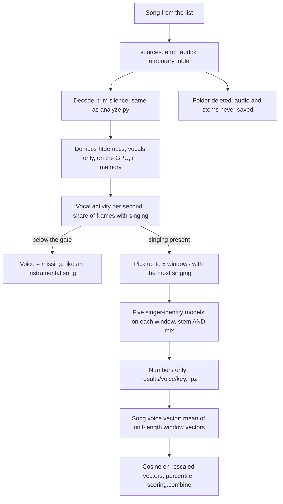

# Voice feature: pipeline design (6 Oct 2026)

Status: DESIGN ONLY. Nothing here is built, and nothing here touches the sealed test run.
Goal: decide, with a test that can actually give an answer, whether a "match the singer" feature belongs in the
recommender (TODO.md item 3: build or drop).

## 1. What the test must answer

> Does adding Voice to Sound find the same artist's songs on **other albums** clearly more often than Sound alone?

The old plan said "keep Voice only if it beats Sound by 10 points on 30 same-artist pairs". Three things in that
sentence need fixing (section 2). The corrected rule is in section 5.

## 2. Findings that shaped the design (measured 6 Oct 2026)

| Finding | Number | What it changes |
| --- | --- | --- |
| Sound finds a same-artist song in the top 10 | 38.6% (any album) but **28.1% when only OTHER albums count** (2,443 songs, 666 artists, 6,839-song library) | Songs on one album share a studio sound. The earlier 45% headline was inflated by the album effect. The bar Voice must clear is about 28%, and same-album songs must be removed from the test |
| 30 pairs cannot show a 10-point gain | With 100 questions the paired difference has a standard error of about 5 points, so a true +10 is detected only about 60% of the time; with 250 questions about 90% | Count every song with a different-album partner as a question, and aim for at least 250 |
| Supply of same-artist pairs | Test split: 197 likely-sung artists with 2+ albums (352 with any singing status). Train split: 571. Validation split: 188. The current test list uses 98 | Enough to reach 250 questions if the test list is topped up (section 4) |
| Voice alone will probably lose to Sound | Sound also hears production, which is shared by an artist's songs; a voice model hears only the voice | The pre-registered question is Sound + Voice against Sound alone, because that is how a user would use it |

## 3. The pipeline

Step by step:

0. **Environment (once).** A separate virtual environment, `~/groovyeverywhere/.venv-voice`, built with `uv` on
   Python 3.12: PyTorch with CUDA 12.8 or newer (the RTX 5070 is a Blackwell card), `demucs`, and the
   SonyCSLParis `ssl-singer-identity` package. It stays apart from `.venv` so that Essentia and TensorFlow are not
   disturbed. First check: `torch.cuda.is_available()` inside WSL. Then time Demucs on 5 songs.
1. **Audio in.** Same path as every other song: `sources.temp_audio()`. The song is re-downloaded (the stored
   numbers cannot be turned back into a voice). Download of the next song overlaps with the GPU work on the
   current one; each song still lives in its own `TemporaryDirectory`.
2. **Separation.** `htdemucs`, vocals stem only, at 44.1 kHz, held in memory. No stem is ever written to disk.
3. **Singing gate.** Vocal activity = share of 1-second frames whose vocal-stem level is above a threshold.
   The threshold is set on the development songs against Jamendo's own vocal / instrumental labels (1,814 vocal
   and 2,306 instrumental songs in the library). It replaces the current "voice class" cut-off, which agrees with
   those labels only 80% of the time. Below the gate: Voice is missing, which `scoring.combine` already handles.
4. **Windows.** Up to 6 non-overlapping windows with the most singing; length read from the Sony model's own
   configuration (to be confirmed in step 0). The choice rule is deterministic, so a re-run picks the same windows.
5. **Embeddings.** All five Sony models (`byol`, `contrastive`, `contrastive-vc`, `uniformity`, `vicreg`; 1,000
   numbers each, MIT licence) on every stem window, and on the same windows of the original mix as a control.
   One pass computes everything, because the audio cannot be kept to try another model later.
6. **Storage.** `results/voice/<key>.npz`: window embeddings (float16), gate statistics, the windows used. A
   separate file, so the main analysis files, the database schema and the freeze are untouched.
7. **Song vector and similarity.** Mean of the unit-length window vectors. Compared with cosine, after the same
   kind of gentle rescaling as Sound if development shows it helps. Turned into a percentile against the pool and
   combined by `scoring.combine` as a whole-song feature (like Rhythm: the same score in every part pair).

## 4. Data plan: three roles, kept apart

| Role | Songs | Used for |
| --- | --- | --- |
| Development | About 100 artists with 2+ albums from the **train** split, plus about 300 other train songs as distractors | Choose the model (1 of 5), stem or mix, how to average windows, rescaling, gate threshold. Not sealed: the Voice models never train on MTG data |
| Voice test | The sealed test split. Top up the current list with the remaining likely-sung artists (up to 197), 3 songs each across 2+ albums, picked with a fixed seed before any result exists | The one official Voice score. The ranking library = all test songs that went through Voice (about 1,500) |
| Not used | Validation split | Left free as a spare check |

Selecting extra test songs does not break the seal, because the choice does not depend on any result.
The Voice protocol (section 5) is frozen first, in `voice_freeze.json`, in the same way as `test_split_freeze.json`.

## 5. Decision rule (to be frozen before the Voice test)

* **Question set:** every analysed test song whose artist has a different-album partner in the Voice library.
* **Candidates for each question:** all other Voice-library songs, minus (a) the song itself, (b) songs on the same
  album and artist, (c) near-copies of the question song (plain Sound cosine of 0.97 or more: the same recording on
  two releases would let Sound win for free).
* **Hit:** a different-album song by the same artist in the top 10. Secondary: mean reciprocal rank.
* **Primary comparison:** Sound + Voice (equal-weight percentiles, 65% floor, as in `scoring.combine`) against
  Sound alone, on the same questions and library. Secondary: Voice alone against Sound alone.
* **Keep Voice** if the paired gain is at least **+10 points** and the 95% range of the gain (resampled over
  questions) stays above 0. Otherwise drop it from the README and the plan, with this evidence as the reason.
* **Sanity checks reported with it:** Voice alone beats random by a wide margin; Voice finds shared genre less well
  than Sound does (a voice model should not be a second style model); the control arm (no separation) shows whether
  Demucs is worth its cost; 20 pairs listened to by ear, to estimate how often "same artist" is not the same singer.

## 6. Logic check: what could go wrong, and the guard

| Risk | Guard |
| --- | --- |
| Not enough questions to see a 10-point gain | At least 250 questions; report the range, not just the point estimate |
| Album effect rewards Sound for production, not voice | Same-album songs removed from the candidates; baseline measured the same way (about 28% in the full library; it will be higher in a 1,500-song library, so it is re-measured there) |
| Same recording on two releases | Near-copy exclusion (cosine 0.97 or more) |
| Same artist is not always the same singer (bands, guests) | The error hits Sound and Voice alike; 20 pairs checked by ear to size it |
| Models trained on clean singing, here fed separated vocals with bleed and artefacts | The mix control and the 5-model comparison on development songs show whether it survives; if not, Voice is dropped, not forced |
| Choosing among many settings on the test songs | All choices made on development songs; one frozen configuration scored once |
| Audio kept by accident (stems, caches) | Stems stay in memory; deletion test with a fake separator proves only the `.npz` remains; stale folders swept at start |
| Pool songs have no Voice numbers yet | Only needed if Voice is adopted: then run the same pass over the 4,406 pool songs (hours, GPU) before it is offered |
| Slow without the GPU | CPU separation takes about 1.5 times the song length, which would be days for 1,500 songs. If the GPU is not usable in WSL, stop and rethink before building |
| Latency for a user's own starting song | Separating a 30 to 60 s clip is seconds on a GPU and about 1.5 times the clip length on a CPU: acceptable for an optional "match the singer" choice |
| Voice missing for an instrumental starting song | Already handled: the feature is reported as unavailable, and no other feature is penalised |

Code that must change if Voice is adopted: `blind_test.FEATURES` and `valid_feature` (no `voice` yet),
`blind_test.pair_similarities` (add a whole-song Voice score that repeats in every pair), the database schema
(one more vector column), `evaluate.py` T7 (it reports "0 of 8 pairs", far too few to mean anything).
`scoring.WHOLE_SONG_WEIGHTS` already has a Voice weight.

## 7. Build order

1. Environment and benchmark (GPU check, Demucs speed, Sony model input length). Decide go / no-go on speed.
2. `analyze_voice.py` (one song, in memory) and `run_voice.py --list` (resumable, writes `results/voice/`),
   with the offline deletion test.
3. Development run, then the development analysis (a script like `metric_check.py`), then freeze.
4. Top up the test list, run it, score it once with `voice_test.py`, write the result into the report.
5. Adopt (pool run, scoring, database) or drop (README and plan edit).

Open decisions for the project owner are listed in the chat reply that came with this file.
